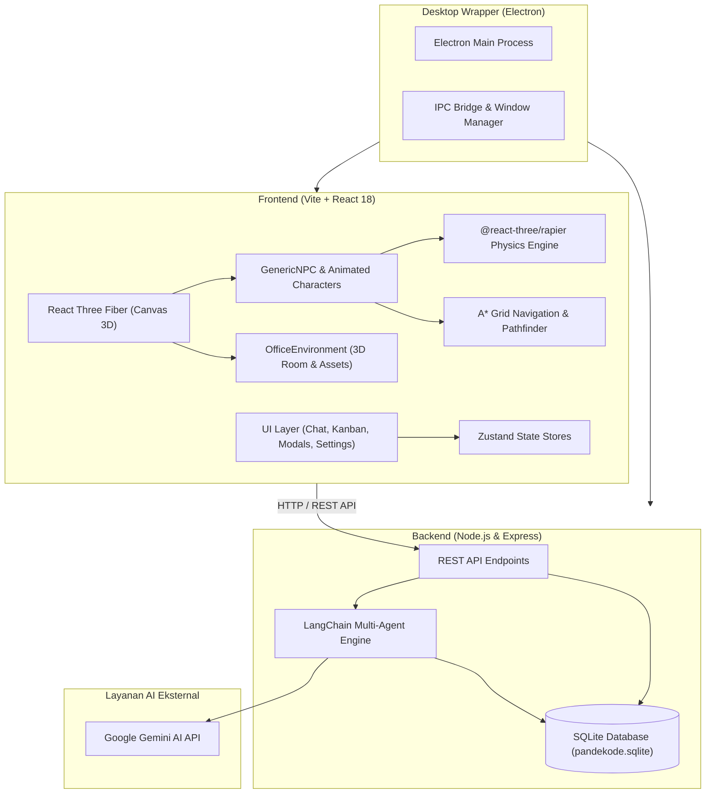

# 🏢 PANDEKODE HQ — Interactive 3D Virtual Workspace with Autonomous AI Agents

> *"A Place Where Your Code Comes to Life"*

[](https://react.dev/)
[](https://threejs.org/)
[](https://docs.pmnd.rs/react-three-fiber)
[](https://rapier.rs/)
[](https://www.electronjs.org/)
[](https://js.langchain.com/)
[](https://ai.google.dev/)
[](https://www.sqlite.org/)

---

## 📌 Ringkasan Cepat untuk GitHub Repository

* **Deskripsi Singkat (GitHub About / Description):**
  > `🏢 Workspace kantor virtual 3D interaktif bertenaga Multi-Agent AI (Gemini + LangChain), React Three Fiber, Rapier Physics, dan Electron. Simulasi software agency tempat instruksi Anda dieksekusi menjadi proyek nyata.`
* **Topics / Tags Rekomendasi:**
  `react`, `threejs`, `react-three-fiber`, `rapier-physics`, `electron`, `langchain`, `gemini-ai`, `multi-agent`, `ai-coding-agent`, `kanban`, `virtual-office`, `gamification`, `sqlite`

---

## 📖 Tentang Proyek

**PANDEKODE HQ** adalah platform **Virtual Office 3D interaktif berbasis web dan desktop native** yang menggabungkan simulasi kehidupan kantor digital (*office life gamification*) dengan sistem **Autonomous AI Coding Agency**.

Di dalam ruang kerja 3D ini, pengguna dapat berperan sebagai **CEO / Founder / Klien** yang memimpin sebuah tim software house digital yang beranggotakan agen-agen AI independen. Setiap NPC AI memiliki persona mendalam, peran teknis spesifik (Product Manager, UI/UX Designer, Frontend, Backend, QA, DevOps, Admin, dan Hospitality), serta kemampuan berkolaborasi secara otonom dalam mendelegasikan tugas, mengelola papan Kanban, melakukan standup meeting, hingga menyusun laporan proyek aplikasi secara otomatis.

Aplikasi ini dibangun menggunakan arsitektur **Monorepo** yang memisahkan frontend 3D (*Vite + React Three Fiber + Rapier*), backend AI (*Express + LangChain + Gemini + SQLite*), dan wrapper desktop (*Electron*) sehingga dapat dijalankan baik di browser web modern maupun sebagai aplikasi mandiri (`.exe`) di sistem operasi desktop.

---

## ✨ Fitur-Fitur Utama

### 1. 🌐 Lingkungan Kantor 3D Interaktif (*Immersive 3D Space*)
* **3D Physics & Navigation**: Ditenagai oleh Rapier Physics dengan sistem pathfinding cerdas berbasis grid A* (`pathfinding.js`) dan algoritma anti-stuck multi-tahap (wall-sliding, dynamic repath, repulsive impulse, safe teleport).
* **Animasi Prosedural Karakter**: Gerakan berjalan, duduk, mengetik, berbicara, dan menghadap lawan bicara dirancang secara prosedural tanpa ketergantungan aset berat.
* **Siklus Waktu & Tata Cahaya Dinamis**: Simulasi waktu kantor dinamis dengan pencahayaan siang/malam (*Day/Night cycle*), lampu eksterior dan neon box *"pandekode"* otomatis menyala saat petang, serta monitor/TV yang otomatis mati saat jam pulang kerja.

### 2. 🤖 Tim Agen AI Otonom (*Multi-Agent Orchestration*)
* **LangChain + Google Gemini Multi-Turn Chain**: Setiap anggota tim memiliki prompt persona, kebiasaan (*quirks*), gaya bahasa unik, serta memori percakapan independen.
* **Autonomous Task Delegation & Action Triggers**: Ketika CEO/Klien memberikan instruksi pembuatan proyek, Project Manager (Agung) secara cerdas memecah instruksi (*breakdown requirements*), membagikan tugas ke tim divisi terkait di papan Kanban, serta menerbitkan laporan eksekutif.
* **Inter-NPC Autonomous Chat**: Karakter dapat saling berdiskusi, melempar pertanyaan, dan mengoordinasikan pekerjaan lintas divisi secara mandiri.

### 3. 🎮 Sistem Kontrol Ganda (*Player & Observer Mode*)
* **Mode Kontrol Karakter CEO (WASD)**: Kendalikan avatar CEO secara langsung dengan sistem pergerakan relatif terhadap kamera (*camera-relative movement*), mekanisme *strafing*, serta sudut pandang kamera TPS / *Over-the-shoulder*.
* **Mode Bebas (Free Orbit Camera)**: Pantau seluruh sudut kantor dan aktivitas tim melalui kontrol kamera orbit bebas.

### 4. 📊 Manajemen Proyek & Gamifikasi Kantor
* **Papan Kanban & Info Board Real-Time**: Sinkronisasi status pengerjaan tugas (*To Do*, *In Progress*, *Review*, *Done*) yang diperbarui otomatis oleh AI maupun secara manual oleh pengguna, dengan penyimpanan persisten di database SQLite.
* **Sistem Suasana Hati (*Mood System*)**: Indikator emosi karakter (Senang, Netral, Stres) yang berfluktuasi berdasarkan beban kerja dan interaksi.
* **Sistem Afinitas & Hubungan**: Peningkatan kedekatan relasi antar karakter berdasarkan intensitas komunikasi.
* **Event Kantor Acak (*Random Events*)**: Munculnya skenario insiden tak terduga (seperti *Server Down*, *Client Emergency*, atau mesin kopi rusak) yang memicu respons reaktif dari tim terkait.
* **Sistem Prestasi (*Achievements & Badges*)**: Penghargaan pencapaian bagi pengguna (misal: proyek pertama selesai, interaksi chat terbanyak).

### 5. 🖥️ Distribusi Desktop Native (Electron Ready)
* Terintegrasi dengan Electron untuk pengemasan aplikasi desktop standalone (`.exe` NSIS installer & portable).
* Proses backend Node.js dan database SQLite otomatis dijalankan dan dikelola langsung di dalam siklus hidup Electron dengan akselerasi perangkat keras WebGL.

---

## 👥 Tim PANDEKODE HQ (NPC Personas & Roles)

| Karakter | Peran / Jabatan | Spesialisasi & Tanggung Jawab |
|---|---|---|
| **Bege** | **CEO & Founder** | Menentukan visi perusahaan, menerima pesanan proyek dari klien, memberikan arahan strategis, dan memimpin tim. |
| **Agung** | **PM & CTO (Full-Stack Architect)** | Mengatur *sprint*, memecah instruksi klien menjadi daftar task di Kanban, arsitektur sistem, dan memimpin standup harian. |
| **Bunga** | **UI/UX Designer** | Merancang antarmuka pengguna, *wireframe*, prototipe Figma, *design system*, dan menjaga estetika visual produk. |
| **Candra** | **Frontend Developer** | Mengimplementasikan desain menjadi kode antarmuka web/mobile interaktif, manajemen *state*, dan animasi. |
| **Dika** | **Backend Developer** | Merancang endpoint API, skema database, logika bisnis server, keamanan data, dan optimasi performa *query*. |
| **Eka** | **QA Engineer** | Pengujian menyeluruh (*corner cases*, regresi, automasi pengujian) serta memastikan standar kualitas sebelum rilis. |
| **Fajar** | **DevOps Engineer** | Mengelola infrastruktur *cloud*, orkestrasi kontainer (Docker/Kubernetes), pipeline CI/CD, dan pemantauan server 24/7. |
| **Gita** | **Receptionist & Office Admin** | Menyambut tamu di lobi, menangani surat/paket, mengelola inventaris kantor, serta pembaruan papan informasi. |
| **Hadi** | **Office Boy & Hospitality** | Menjaga kenyamanan kantor, meracik kopi/teh di Pantry, serta mengelola operasional pencahayaan dan fasilitas. |

---

## 🏗️ Arsitektur Sistem



---

## 🛠️ Tech Stack

### Frontend
* **Core**: [React 18](https://react.dev/), [Vite](https://vitejs.dev/)
* **3D Graphics**: [Three.js](https://threejs.org/), [@react-three/fiber](https://docs.pmnd.rs/react-three-fiber), [@react-three/drei](https://github.com/pmndrs/drei)
* **Post-Processing**: `@react-three/postprocessing`
* **Physics Engine**: [@react-three/rapier](https://github.com/pmndrs/react-three-rapier)
* **Pathfinding**: `pathfinding` (A* grid system) & `three-pathfinding`
* **State Management**: [Zustand](https://github.com/pmndrs/zustand)

### Backend
* **Runtime**: [Node.js](https://nodejs.org/) (ES Modules)
* **Framework**: [Express.js](https://expressjs.com/)
* **AI Orchestration**: [LangChain](https://js.langchain.com/), `@langchain/google-genai`
* **AI Model**: Google Gemini (Flash / Pro family)
* **Database**: [SQLite](https://www.sqlite.org/) via `sqlite` & `sqlite3` driver
* **Security & Utility**: `dotenv`, `cors`

### Desktop Native
* **Desktop Shell**: [Electron](https://www.electronjs.org/)
* **Packaging & Builder**: [electron-builder](https://www.electron.build/) (Target: Windows NSIS Installer & Portable Executable)

---

## 📁 Struktur Direktori Proyek

```text
PANDEKODE_HQ/
├── electron/                   # Konfigurasi & entry point aplikasi desktop Electron
│   ├── main.cjs                # Lifecycle Electron & child process backend launcher
│   └── preload.cjs             # IPC safe bridge
├── packages/
│   ├── frontend/               # Kode sumber antarmuka 3D & UI Web
│   │   ├── src/
│   │   │   ├── components/
│   │   │   │   ├── game/       # Komponen gameplay, kontrol kamera, & NPC 3D
│   │   │   │   ├── ui/         # Modal (ChatBox, Kanban, Profile, Settings, Events)
│   │   │   │   └── shared/     # Komponen UI umum yang dapat digunakan kembali
│   │   │   ├── systems/        # Logika sistem (lighting, events, keyboard listeners)
│   │   │   ├── stores/         # State management berbasis Zustand
│   │   │   ├── OfficeEnvironment.jsx # Model & tata letak lingkungan kantor 3D
│   │   │   ├── App.jsx         # Komposisi utama game & scene
│   │   │   └── pathfinder.js   # Modul algoritma pathfinding A*
│   │   └── package.json
│   └── backend/                # Server API, database, & orkestrasi agen AI
│       ├── src/
│       │   ├── chat.js         # Persona NPC, LangChain agent chain, & action parser
│       │   ├── database.js     # Skema & query SQLite (Kanban, InfoBoard, Logs)
│       │   └── index.js        # Server Express & endpoint REST
│       └── package.json
├── package.json                # Root monorepo workspace scripts
└── README.md                   # Dokumentasi utama repositori
```

---

## 🚀 Panduan Memulai (*Getting Started*)

### 1. Prasyarat Sistem
* [Node.js](https://nodejs.org/) versi 18 atau lebih tinggi
* NPM versi 9 atau lebih baru
* API Key dari [Google AI Studio](https://aistudio.google.com/) untuk akses Gemini AI

### 2. Kloning & Instalasi Dependensi
```bash
# Clone repositori
git clone https://github.com/username/pandekode-hq.git
cd pandekode-hq

# Install seluruh dependensi monorepo
npm install
```

### 3. Konfigurasi Lingkungan (*Environment Variables*)
Buat berkas `.env` di dalam folder `packages/backend/`:
```bash
# packages/backend/.env
PORT=3000
GOOGLE_API_KEY=your_gemini_api_key_here
```

### 4. Menjalankan Mode Pengembangan (*Development*)

#### Opsi A: Jalankan di Web Browser
Menjalankan frontend dan backend secara paralel:
```bash
npm run dev
```
Buka browser di `http://localhost:5173`. Backend otomatis berjalan di port `3000`.

#### Opsi B: Jalankan sebagai Aplikasi Desktop Electron
```bash
npm run desktop:dev
```
Perintah ini akan menyalakan server Vite, server Express backend, dan jendela native Electron secara terpadu.

### 5. Membangun Aplikasi Executable Desktop (`.exe`)
Untuk menghasilkan installer mandiri Windows:
```bash
# Membuat installer NSIS dan versi Portable di folder dist-electron/
npm run build:exe
```

---

## 🎯 Visi & Roadmap Masa Depan

* [x] Fondasi kantor virtual 3D interaktif berbasis React Three Fiber & Rapier.
* [x] Implementasi 9 NPC AI dengan persona, tanggung jawab, dan memori percakapan independen.
* [x] Integrasi LangChain + Google Gemini untuk otomatisasi delegasi tugas dan papan Kanban.
* [x] Paket desktop native mandiri berbasis Electron.
* [ ] **Integrasi Eksternal Nyata**:
  * Koneksi langsung ke **GitHub API** (membuat issue, branch, dan commit kode nyata dari instruksi NPC).
  * Integrasi basis data awan **Supabase** dan penyimpanan aset **Cloudflare R2**.
  * Kolaborasi dengan mesin kode otomatis seperti **V0 / AI code generators**.
* [ ] **Kustomisasi & Desain 3D**:
  * Pemuatan model karakter kustom GLTF/GLB dengan animasi Mixamo.
  * Personalisasi dekorasi dan penataan tata ruang meja kantor oleh pemain.
* [ ] **Sistem Kolaborasi Multi-Player**: Kemampuan mengundang rekan developer lain ke dalam ruang kantor virtual yang sama.

---

## 📄 Lisensi & Kontribusi

Proyek ini dikembangkan dan dikelola oleh **Pandekode HQ**.  
Hak Cipta © 2026 PANDEKODE. Seluruh hak cipta dilindungi undang-undang.
